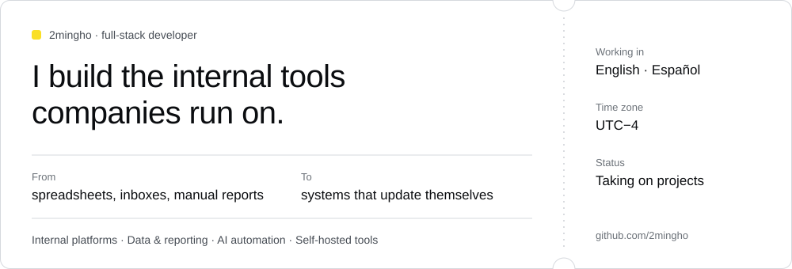

<picture>
  <source media="(prefers-color-scheme: dark)" srcset="assets/pase-oscuro.svg">
  
</picture>

Most of what I ship never shows up on a public profile. It runs inside companies: the platform a large team plans its week in, the report a client reads at 7 a.m., the pipeline that takes a repetitive job off someone's desk. This page is a short tour of that work.

### Selected work

Client names stay out of it. I'm glad to walk through any of these on a call.

| | |
|:--|:--|
| **Team operations platform** | Planning, staffing, overtime and expenses for large teams. Roles, approvals and an audit trail, so nobody has to ask who changed what.  Next.js · TypeScript · PostgreSQL |
| **Press monitoring engine** | Reads 70+ news outlets every two hours, finds the articles that actually mention each client and sends a clean daily report with an Excel attached. Rules first, language models only where a rule can't decide.  Node.js · SQLite · LLMs |
| **Executive reporting** | Monthly reports and dashboards for corporate and financial clients, built straight from raw exports instead of copy and paste.  Python · JavaScript |
| **Video production server** | A home server that cuts long streams into vertical clips, captions them and publishes them. The core is open source as [StreamClipper](https://github.com/2mingho/streamclipper).  Node.js · FFmpeg · MCP |
| **Field quoting app** | Quotes priced and sent from the workshop floor for a custom furniture business.  Flutter |
| **Deck automation** | Presentation decks filled from data and templates, for teams that rebuild the same slides every month.  Python |

### How I work

I measure before I automate. Every AI step I've shipped was checked against real human decisions first, and the numbers decide whether it goes live.

I build things that keep running when I'm not looking: they retry, they tell someone when they fail, and they can be updated without stopping the work.

Data stays where it belongs. Secrets live outside the code, and when privacy matters the system runs on the client's own hardware.

### Tools I reach for

TypeScript, Node.js, Next.js, React, Python, Kotlin, Flutter, PostgreSQL, SQLite, Linux, FFmpeg, and language models through APIs or running locally.

### Get in touch

[domingoimportante60@gmail.com](mailto:domingoimportante60@gmail.com)
